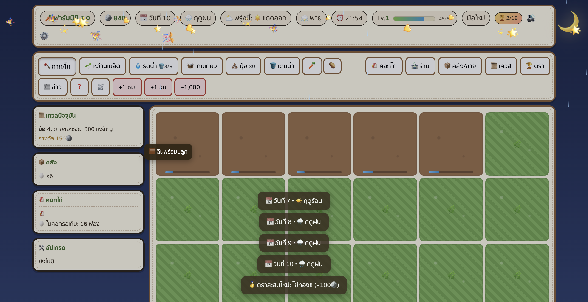

# 🥕 ฟาร์มมินิ 4.0 — เกมปลูกผัก + ปศุสัตว์ในเบราว์เซอร์

เกมปลูกผักเล่นบนคอมผ่านเบราว์เซอร์ ออฟไลน์ 100% ไม่ต้องต่อเน็ต ไม่ต้องติดตั้งอะไร
**เวอร์ชั่น 4.0:** ระบบปศุสัตว์เต็มรูปแบบ — สัตว์ 7 ชนิด, อาคาร 3 หลังที่อัปเกรดได้, ระดับสัตว์ 4 ขั้น, ระบบอาหารสัตว์ที่เชื่อมกับการปลูกพืช



## วิธีเล่น

ดับเบิลคลิกไฟล์ `index.html` (Chrome / Safari / Edge ก็ได้) — จบเลย

```
ไถดิน → หว่านเมล็ด → รดน้ำ → รอผักโต → เก็บเกี่ยว → ขาย → ซื้อไก่/เมล็ดใหม่ → วนต่อ
```

## ปุ่มลัด

| ปุ่ม | ทำอะไร |
|---|---|
| `1`–`6` | สลับเครื่องมือ (ถาก/หว่าน/รดน้ำ/เก็บ/ปุ๋ย/เติมน้ำ) |
| `Esc` | ปิดหน้าต่าง |
| เมาส์ชี้แปลง | tooltip รายละเอียด (ความคืบหน้า %, ความชื้น, ปุ๋ย, รอบเก็บซ้ำ) |

## ระบบในเกม

### พื้นฐาน
- **เริ่มเพียง 2 แปลง** จากความจุ 6×6 แล้วซื้อปลดล็อกทีละแปลง ราคาเริ่ม `60 → 90 → 130 → 180` เหรียญ; ขยายความจุเป็น 8×8 (Lv4) และ 10×10 (Lv8)
- **พืช 10 ชนิด** ปลดล็อกตามเลเวล — สตรอเบอร์รี/พริก/องุ่นเก็บซ้ำได้หลายรอบ
- **ฤดูกาล** ร้อน→ฝน→หนาว (7 วัน/ฤดู) พืชมีฤดูชอบ (+30%) และฤดูแพ้ (−30%)
- **อากาศรายวัน**: ☀️แดด • 🌧️ฝน • ⛈️พายุ (ผักเสียหาย) • 🔥ภัยแล้ง (น้ำระเหย ×2)
- **ระบบน้ำ**: ขาดน้ำ→หยุดโต→ตายใน 6 ชม.เกม • น้ำพอตลอด = ผล ⭐ ขาย 1.5 เท่า
- **ปุ๋ย** โตเร็ว 25% • **ตลาด** ราคาผันผวน ±25% ทุกวัน
- **เควส 10 ขั้น** จบฉายา "ราชาฟาร์ม 👑" • เลเวล/XP

### 🛖 ปศุสัตว์ (ใหม่ในเวอร์ชั่น 4)
- **สัตว์ 7 ชนิด** ปลดล็อกตามเลเวล — แต่ละชนิดมีผลผลิต รอบเวลา ค่าอาหาร และฤดูที่ชอบ/แพ้ต่างกัน

  | สัตว์ | Lv | ราคา | ผลผลิต | รอบ | อาหาร/วัน | บ้าน |
  |---|---|---|---|---|---|---|
  | 🐔 ไก่ | 1 | 250 | 🥚 ไข่ไก่ 45 | 8 ชม. | 1 | เล้าไก่ |
  | 🦆 เป็ด | 3 | 520 | 🍳 ไข่เป็ด 78 | 10 ชม. | 1 | เล้าไก่ |
  | 🐝 ผึ้ง | 5 | 1,400 | 🍯 น้ำผึ้ง 150 | 16 ชม. | — | ลานผึ้ง |
  | 🐐 แพะ | 6 | 1,900 | 🥛 นมแพะ 165 | 12 ชม. | 2 | โรงนา |
  | 🐑 แกะ | 7 | 2,800 | 🧶 ขนแกะ 330 | 24 ชม. | 2 | โรงนา |
  | 🐄 วัว | 9 | 4,200 | 🍼 นมวัว 280 | 16 ชม. | 3 | โรงนา |
  | 🐖 หมู | 11 | 5,600 | 🍄 ทรัฟเฟิล 700 | 30 ชม. | 4 | โรงนา |

- **อาคาร 3 หลัง อัปเกรดได้** — เล้าไก่ (12→20→30 ตัว), ลานผึ้ง (สร้าง→4→9), โรงนา (สร้าง→6→12→20) ขั้นสูงให้โบนัสความเร็วผลผลิตด้วย
- **ระดับสัตว์ 4 ขั้น** (ธรรมดา → เลี้ยงดี ⭐ → ยอดเยี่ยม ⭐⭐ → ตำนานฟาร์ม 👑) — สะสมจากการให้อาหารและเก็บผลผลิต ระดับสูงผลิตเร็วขึ้นถึง 55% และมีโอกาสได้ของเกรด ⭐/🥇 มากขึ้น
- **ความสุข** — สัตว์ที่อิ่มผลิตเร็วขึ้น 25% สัตว์ที่อดอยากหยุดผลิต
- **อาหารสัตว์** — ซื้อได้ชิ้นละ 26🪙 หรือ **แปรรูปจากพืชในคลัง** (แครอท ×2 → 5, มันฝรั่ง ×2 → 6, ข้าวโพด ×1 → 8) ซึ่งถูกกว่ามาก ทำให้การปลูกพืชกับการเลี้ยงสัตว์เชื่อมกันจริง
- **🐝 ผึ้งเร่งการโตของพืช** ทุกแปลง +5% ต่อรัง (เพดาน +25%)
- **ผลผลิต 3 เกรด** ธรรมดา / ⭐ ×1.6 / 🥇 ×3 — สุ่มแบบ deterministic (เล่นซ้ำได้ผลเดิม)
- **ผลผลิตล้นไม่หาย** — ถ้าไม่ได้เก็บนาน ระบบจะเก็บเข้าคลังให้อัตโนมัติแทนการลบทิ้ง

### ✨ ใหม่ในเวอร์ชั่น 2
- 🐔 **คอกไก่** — จุดเริ่มต้นของระบบปศุสัตว์ (v4 ขยายเป็นสัตว์ 7 ชนิด ดูหัวข้อด้านบน)
- 🏆 **ตราสะสม 24 ชิ้น** — ทำเงื่อนไขสำเร็จรับ 100🪙/ชิ้น พร้อม confetti ฉลอง
- ⛅ **พยากรณ์อากาศพรุ่งนี้** + 🔭 ดูอากาศ 3 วันข้างหน้าในหน้าสถิติ (ระบบซื่อสัตย์ ไม่สุ่มทับ)
- 📈 **กราฟราคาย้อนหลัง 10 วัน** (sparkline) ในร้านและคลัง
- 🌗 **ฉากกลางวัน/หัวค่ำ/กลางคืนจริง** — ท้องฟ้าเปลี่ยนตามเวลาในเกม มี🌞/🌙
- 🌧️ **เอฟเฟกต์อากาศเต็มจอ** — ฝนตกเป็นเส้น, คลื่นความร้อน, แสงแดด
- 🖱️ **tooltip แปลง** บอกทุกอย่างที่ชี้ • ต้นใกล้ตายสั่นเตือน 🥀
- ⚙️ **ตั้งค่าความเร็วเกม** 0.5× / 1× / 2× / 4× + ปิดเสียงได้
- 🥇 **ไข่ทอง** ฟาร์มไก่ขายได้ 135🪙/ฟอง
- 📊 **หน้าสถิติฟาร์ม** สรุปทุกตัวเลขที่เคยทำ
- 💾 **เซฟเก่าอัปเกรดอัตโนมัติ (v1 → v4)** — ผู้เล่นเดิมรักษาพื้นที่ทั้งหมด; ไก่กองเดิมถูกแปลงเป็นสัตว์รายตัวครบทุกตัว ไข่ที่ค้างคอกไม่หาย และได้อาหารสัตว์ตั้งต้นให้ฝูงเดิม

## การเซฟ

- เซฟอัตโนมัติทุก 30 วินาที + ทุกครั้งที่ทำ action + ก่อนปิดหน้า (`localStorage`)
- ปิดคอมไปเลย — กลับมาผักโตต่อ ไก่ให้ไข่ต่อ (นับสูงสุด 7 วันเกม)
- เริ่มใหม่: ปุ่ม ⚙️ → ล้างเซฟ หรือ 🗑️ ในเกม

## โหมดทดสอบ

ต่อท้าย URL ด้วย `?debug=1` → มีปุ่ม +1 ชม. / +1 วัน / +1,000 เงิน

## รันเทสต์ (สำหรับนักพัฒนา)

```bash
node tests/test-logic.js     # ระบบพื้นฐาน (108 tests)
node tests/test-v2.js        # ไก่/ตรา/พยากรณ์/migration (40 tests)
node tests/test-animals.js   # ปศุสัตว์ v4: สัตว์/อาคาร/อาหาร/ระดับ/migration (117 tests)
```

รวม **265 tests** — Node ล้วน ไม่ต้องติดตั้ง dependency

## ถ้า localStorage ถูกบล็อก

```bash
cd โฟลเดอร์นี้
python3 -m http.server 8000
# เปิด http://localhost:8000
```

## โครงสร้างไฟล์

```
index.html          หน้าเกม (v2: weather layer, celestial, tooltip)
css/style.css       ธีมไม้ + ฉากวัน/คืน + เอฟเฟกต์อากาศ + confetti
js/data.js          ตารางพืช/เควส/อัปเกรด/อากาศ/คอกไก่/ตราสะสม
js/state.js         logic ทั้งหมด (ปลูก/โต/ตาย/ไก่/ไข่/ตรา)
js/weather.js       สุ่มอากาศ deterministic ตามวัน
js/market.js        ราคา + การขาย
js/quests.js        ระบบเควส
js/animals.js       ปศุสัตว์: สัตว์/อาคาร/อาหาร/ความสุข/ระดับ/ผลผลิต
js/save.js          เซฟ/โหลด + migration v1/v2/v3→v4 + ออฟไลน์
js/ui.js            หน้าจอ/toast/ฉาก/sparkline
js/main.js          loop + ปุ่ม + ความเร็วเกม
tests/              เทสต์ 265 ข้อ (Node ล้วน ไม่ต้องติดตั้งอะไร)
```

ปรับความเร็วพื้นฐานได้ที่ `DAY_REAL_SEC` ใน `js/data.js` (default 240 = 1 วันเกม = 4 นาทีจริง)